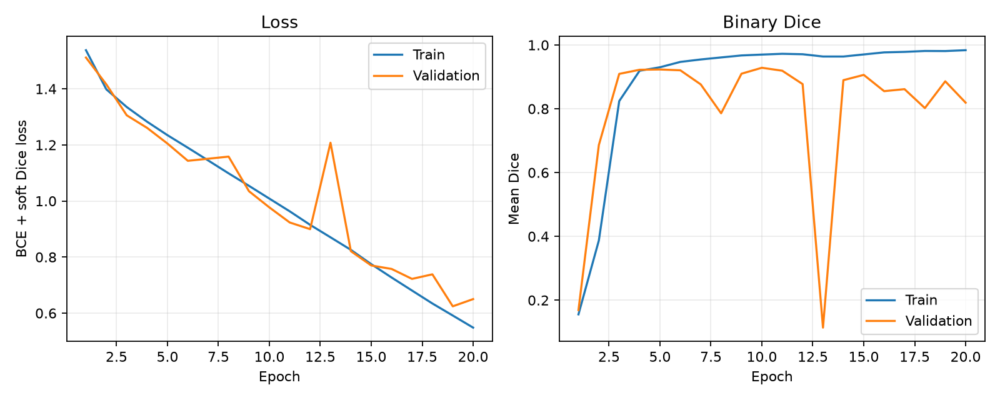
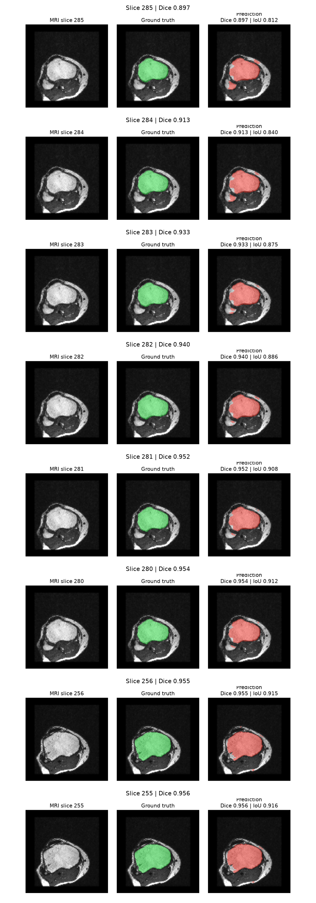
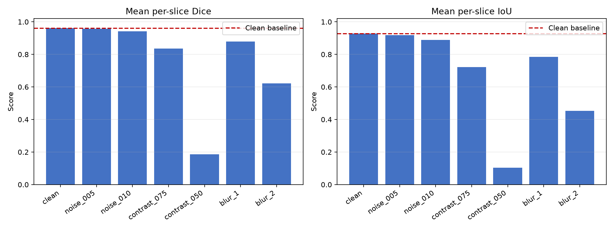
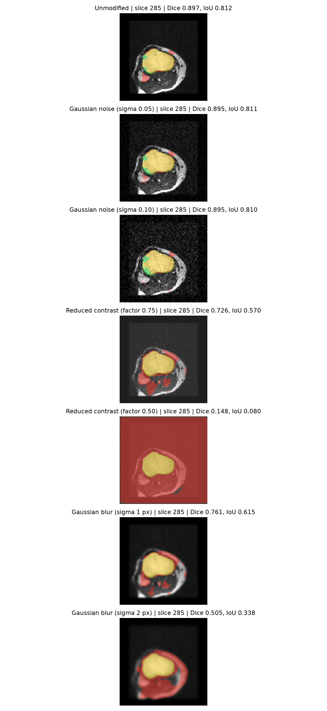

# PatellaVision AI: Reliability Characterization of a U-Net Baseline for Binary Knee MRI Bone Segmentation

**Subtitle:** A single-volume exploratory study under controlled image-quality perturbations

**Authors:** [Add team member names]  
**Project type:** Experimental computer-vision research prototype  
**Status:** Results below are from the recorded local CPU experiments.

## Team work allocation

Both planned project workstreams have been implemented:

| Workstream | Delivered project work |
|---|---|
| Member 1 - AI/ML | Dataset pair discovery and contiguous split; DICOM and mask preprocessing; U-Net; CPU training and validation-based checkpoint selection; held-out Dice/IoU evaluation. |
| Member 2 - image processing, application, and research | Controlled synthetic noise, contrast, and blur evaluation; overlays and figures; Streamlit demo; literature context; report and presentation materials. |

These are role-based work areas, not a claim about which named person
individually authored each file. Add names and confirm actual contributions
with both team members before submission.

> **Scope and safety:** This project performs experimental segmentation of
> annotated knee MRI slices. It does not diagnose patellar dislocation or any
> other medical condition, predict recurrence, or support clinical decisions.

## Abstract

This project developed a compact U-Net pipeline for binary segmentation of
annotated knee-bone regions in 2D MRI slices. The available
KneeBones3Dify-Annotated-Dataset contains 286 512 x 512 DICOM slices and
corresponding PNG masks. Files were paired by numeric slice order after
inspection and visual overlay checks. A per-slice intensity normalization
pipeline and nearest-neighbor mask resizing were used to prepare 128 x 128
model inputs. The ordered volume was partitioned into contiguous training,
validation, and test blocks of 197, 42, and 43 slices, respectively, with two
intervening slices omitted at each split boundary. A U-Net was trained for 20
epochs on CPU using a sum of binary cross-entropy and soft Dice losses; the
checkpoint with the highest validation Dice was selected. On the held-out
block, mean per-slice Dice and IoU were 0.9622 and 0.9276. Synthetic
perturbation experiments showed reduced mean Dice under Gaussian noise with
sigma 0.10 (0.9410), contrast factor 0.50 (0.1869), and Gaussian blur with
sigma 2 pixels (0.6222). Because all slices come from one volume, these
results are exploratory and do not establish patient-level generalization.
The contribution is an empirical, same-split sensitivity characterization of
this baseline, not a new segmentation architecture or a claim of being the
first study of knee MRI segmentation or image-quality robustness.

## 1. Introduction

Medical-image segmentation assigns a label to each pixel or voxel to delineate
an anatomical structure. U-Net is an encoder-decoder convolutional architecture
with skip connections that combine coarse contextual features with finer
spatial information [1]. This project applies a small 2D U-Net to annotated
knee MRI slices and examines how predictions change after controlled
image-quality perturbations.

The work is deliberately limited to segmentation. It does not infer a
diagnosis, prognosis, or clinical outcome. Dataset size and structure also
limit the strength of any generalization claim: the supplied README describes
one 286-slice volume, not a multi-patient cohort.

## 2. Problem statement and objectives

### Problem statement

Given a 2D knee MRI slice, predict a binary mask corresponding to the
foreground pixels in its paired manual annotation.

### Objectives

1. Verify and pair the supplied DICOM images and PNG masks.
2. Implement reproducible preprocessing and a leakage-aware ordered split.
3. Train a compact U-Net using PyTorch on CPU.
4. Report Dice and IoU on a test block not used for training or checkpoint
   selection.
5. Measure performance changes under synthetic noise, contrast, and blur.
6. Provide a demonstration interface to browse one DICOM MR series, inspect
   per-slice predictions, and record research review notes.

### Study contribution and research question

The contribution of this project is a focused empirical characterization of
one trained binary U-Net baseline on one ordered MRI volume. With the
checkpoint, test masks, threshold, and preprocessing held fixed, the project
compares clean-image performance against six controlled perturbation
conditions (two noise levels, two contrast factors, and two blur levels), and
provides per-slice metrics and visual comparisons. The principal research
question is:

> How does this trained U-Net baseline's segmentation overlap on the
> available held-out slice block change under the specified synthetic
> noise, contrast, and blur perturbations?

This is a reproducible project-specific empirical contribution, not a novel
architecture, a new general robustness method, or evidence that these exact
tests have not appeared elsewhere. A separate, systematic literature review
and multi-volume evaluation would be needed to make broader novelty or
generalization claims. The dataset contains only one volume, and the same
held-out block was used for the clean test evaluation and perturbation
analysis; conclusions therefore apply only to this experiment.

## 3. Related work

Ronneberger, Fischer, and Brox introduced U-Net for biomedical image
segmentation, using a contracting path for context and an expanding path with
skip connections for localization [1]. The present implementation follows
that high-level encoder-decoder idea but is a compact, single-channel, 2D
binary model.

Isensee and colleagues' nnU-Net study emphasizes that preprocessing,
architecture configuration, training, and postprocessing choices all matter
for biomedical segmentation [2]. The current project does not implement
nnU-Net; the paper is relevant as context for the importance of a complete
pipeline and cautious evaluation.

Knee-bone segmentation from MRI also predates this project; for example,
Thengade and Rajurkar published a work titled *Segmentation of Knee Bone
Using MRI* [3]. Mahendrakar and colleagues reviewed MRI-based knee-joint
segmentation methods covering bone, cartilage, and menisci, including
automatic and semi-automatic approaches [4]. These works establish that knee
MRI segmentation is an existing research area; the present project does not
claim the broad task or its U-Net architecture as novel.

Prior studies also show why validation must be interpreted in the context of
the target anatomy and reference standard. Sun and colleagues evaluated an
MRI-based AI cartilage-segmentation model using natural tibial-plateau
cartilage and CT-based comparisons, reporting different results for 2D
overlap and 3D consistency [5]. Their cartilage task and reference methods
differ from this project's binary annotated foreground, so their scores are
not directly comparable. Jung and colleagues compared knee MRI sequences for
segmentation by measuring tissue-boundary edge sharpness and contrast [6].
That study motivates attention to image appearance and sequence selection;
it does not evaluate this project's specific synthetic noise, contrast, or
blur protocol.

The narrower contribution here is the recorded comparison across six
specified synthetic conditions for one trained baseline and one
single-volume split. The literature search performed for this project was
limited and is not a systematic review; it cannot establish global
originality or that the perturbation experiment is the first of its kind.

Bien and colleagues' MRNet study used 1,370 knee MRI examinations to classify
general abnormality, ACL tears, and meniscal tears, and evaluated how model
predictions affected expert interpretation [8]. This is a relevant example
of research on AI-assisted knee-MRI review, but its targets are examination-
level imaging findings, not a recommendation about whether surgery is
indicated. Its classification task and labels differ from the present
pixel-level segmentation experiment.

## 4. Dataset and pairing

The local dataset README describes MRI T2-weighted images without fat
suppression and 286 slices of a steady-state sequence at 512 x 512, with
voxel-wise masks manually annotated by a specialist. Inspection found 286
DICOM files and 286 PNG masks. The DICOM filenames have numeric suffixes
`_0` through `_285`; the mask filenames are `Mask_001.png` through
`Mask_286.png`. Pairing uses the numeric slice index, so DICOM `_n` is paired
with `Mask_(n+1)`.

The dimensions of paired images and masks were checked, and sampled overlays
were reviewed. This supports the implemented ordering but does not replace
independent annotation validation. The PNG masks were binary in the inspected
files and all nonzero values are treated as foreground. Thus, the present
model does not produce separate labels for different bones.

### Data split

The ordered volume was divided into contiguous blocks:

| Split | Slices | Indices |
|---|---:|---|
| Train | 197 | 0-196 |
| Omitted boundary gap | 2 | 197-198 |
| Validation | 42 | 199-240 |
| Omitted boundary gap | 2 | 241-242 |
| Test | 43 | 243-285 |

The test block was not used for training or checkpoint selection. A small gap
does not make the split independent: slices within a volume are correlated,
and this is not a patient-level split.

## 5. Methodology

### 5.1 Preprocessing

Each DICOM slice is read as a 2D pixel array. `MONOCHROME1` images are
inverted. The 1st and 99th intensity percentiles are used as clipping bounds;
intensities are clipped and linearly scaled to [0, 1]. Images are resized to
128 x 128 by bilinear interpolation. Binary masks are resized to the same
shape using nearest-neighbor interpolation to preserve label values.

### 5.2 U-Net model

The model has one input channel and one foreground-logit output channel.
Encoder and decoder blocks use two 3 x 3 convolutions, batch normalization,
and ReLU activations. Four max-pooling stages reduce spatial resolution, and
transposed convolutions upsample decoder features. At each decoder stage, the
corresponding encoder feature map is concatenated through a skip connection.
The base channel width is 8, doubling at each deeper level. A final 1 x 1
convolution produces pixel logits; sigmoid and a 0.5 threshold produce the
binary prediction.

### 5.3 Training configuration

| Setting | Value |
|---|---|
| Framework | PyTorch 2.15.0+cpu |
| Device | CPU; no NVIDIA GPU |
| Input size | 128 x 128 |
| Epochs | 20 |
| Batch size | 8 |
| Base channels | 8 |
| Optimizer | Adam |
| Learning rate | 0.001 |
| Loss | Binary cross-entropy with logits + soft Dice loss |
| Random seed | 42 |
| Checkpoint selection | Highest validation binary Dice |
| Selected epoch | 10 |

### 5.4 Segmentation metrics

For binary reference mask \(G\) and prediction \(P\), where TP, FP, and FN
are pixel counts:

\[
\mathrm{Dice} = \frac{2|P \cap G|}{|P|+|G|}
= \frac{2\,TP}{2\,TP+FP+FN}
\]

\[
\mathrm{IoU} = \frac{|P \cap G|}{|P \cup G|}
= \frac{TP}{TP+FP+FN}
\]

Mean per-slice metrics are computed for each test slice and then averaged.
Pooled pixel metrics aggregate TP, FP, and FN counts across all test pixels
before calculating the score. The two aggregation methods are reported
separately.

### 5.5 Reliability experiments

The trained checkpoint and test masks were held fixed. Perturbations were
applied after normalization and resizing, and perturbed intensities were
clipped to [0, 1]:

- Additive zero-mean Gaussian noise with standard deviations 0.05 and 0.10.
- Reduced contrast by multiplying intensity deviations from 0.5 by factors
  0.75 and 0.50.
- Gaussian blur with sigma 1 and 2 pixels.

Noise generation used a fixed seed and slice index for reproducibility. These
are controlled synthetic image changes, not calibrated simulations of MRI
scanner artifacts.

## 6. Results

### 6.1 Training and test results

The best validation Dice was 0.9286 at epoch 10. The checkpoint from that
epoch was evaluated once on the 43 held-out slices:

| Test metric | Result |
|---|---:|
| Mean per-slice Dice | 0.9622 |
| Mean per-slice IoU | 0.9276 |
| Pooled pixel Dice | 0.9633 |
| Pooled pixel IoU | 0.9292 |

The test montage is ordered from the lowest Dice slice upward. The lowest
per-slice Dice was 0.8965 on slice 285. Test metrics are calculated at the
model's 128 x 128 input resolution.

### 6.2 Controlled reliability results

| Test input condition | Mean Dice | Mean IoU | Dice change vs. clean |
|---|---:|---:|---:|
| Unmodified | 0.9622 | 0.9276 | 0.0000 |
| Gaussian noise, sigma 0.05 | 0.9575 | 0.9190 | -0.0046 |
| Gaussian noise, sigma 0.10 | 0.9410 | 0.8894 | -0.0212 |
| Contrast factor 0.75 | 0.8367 | 0.7225 | -0.1255 |
| Contrast factor 0.50 | 0.1869 | 0.1032 | -0.7753 |
| Gaussian blur, sigma 1 px | 0.8780 | 0.7839 | -0.0842 |
| Gaussian blur, sigma 2 px | 0.6222 | 0.4536 | -0.3400 |

The clean reliability run reproduced the earlier clean test means. Among the
tested synthetic conditions, the largest decrease occurred with contrast
factor 0.50, followed by blur with sigma 2 pixels. Mild Gaussian noise caused
a smaller change in this experiment.

## 7. Discussion

The saved model produced high overlap scores on the contiguous test block from
the same volume. This indicates that the implemented pipeline can fit and
segment slices within this dataset under the tested split; it does not show
that it will perform similarly on a new patient or acquisition.

Performance was sensitive to stronger contrast reduction and blur. This is
consistent with the model relying on image appearance learned from the
unmodified training distribution, but these tests alone do not identify a
clinical cause or establish a scanner robustness claim. The training curve
also shows validation fluctuations, reinforcing that a single split and
single seed provide limited evidence.

The metric is binary foreground overlap. It does not measure anatomical
plausibility, distinguish separate bones, or quantify clinical usefulness.

## 8. Limitations and ethics

1. The dataset contains one volume, so patient-level generalization cannot be
   measured.
2. Adjacent slices are spatially related; a contiguous holdout and two-slice
   gaps reduce some direct mixing but cannot eliminate dependence between
   parts of one volume.
3. Results depend on the assumed numeric filename pairing and on the supplied
   annotations; only visual samples and dimensions were checked.
4. The 128 x 128 input reduces the original 512 x 512 resolution.
5. All annotated foreground is merged into one class.
6. No confidence calibration, uncertainty quantification, external test, or
   prospective clinical evaluation was performed.
7. Noise, contrast, and blur strengths are synthetic and not calibrated to
   real MRI acquisition variation.
8. The Streamlit application supports visual review and research notes across
   one series, but is a research/teaching demonstration only, not a medical
   device or surgical-planning tool.
9. The dataset directory contains a `LICENSE` file beginning with GPL-3.0
   text. The license's applicability to the MRI data itself has not been
   established here; check the dataset provider's terms before redistribution.
10. Public knee-MRI resources do not automatically provide surgical-decision
    labels. MRNet provides report-derived abnormality, ACL-tear, and
    meniscal-tear labels [8, 9], while NYU fastMRI provides MRI data under a
    separate application and data-use agreement [10]. Neither resource, as
    described by its provider, supplies a validated ground-truth label for
    whether surgery was needed. Such a research question would require a
    separate, appropriately approved cohort with clinical context and
    clinician-reviewed treatment and outcome labels.

## 9. Project-specific contribution and novelty boundary

The defensible contribution is the completed, reproducible experiment:
verified slice-order pairing, one compact U-Net baseline, a documented
contiguous slice split, a clean held-out score, six controlled perturbation
comparisons, and per-slice/visual failure evidence. In this experiment,
reducing contrast to factor 0.50 and applying blur with sigma 2 pixels were
associated with the largest decreases in mean Dice relative to the clean
condition.

These observations are specific to one checkpoint, one volume, one split,
and the perturbation definitions in this report. They should be presented as
an exploratory case study rather than a universal ranking of MRI
degradations. The method is a U-Net baseline; no new model architecture,
augmentation-training strategy, clinical workflow, or first-of-its-kind
claim is proposed.

## 10. Conclusion

A compact U-Net pipeline was trained and evaluated for binary segmentation
of annotated knee MRI slices. On a 43-slice contiguous holdout from one
volume, the measured mean per-slice Dice was 0.9622 and mean IoU was 0.9276.
Synthetic perturbations showed lower scores under strong contrast reduction
and blur. The results demonstrate a functioning project pipeline and motivate
further study, but they are exploratory and cannot support claims of
patient-level or clinical performance. External, patient-separated data and
careful license review are required for stronger conclusions.

## References

1. Ronneberger, O., Fischer, P., & Brox, T. (2015). U-Net: Convolutional
   Networks for Biomedical Image Segmentation. In *Medical Image Computing
   and Computer-Assisted Intervention – MICCAI 2015* (pp. 234-241). Springer.
   https://doi.org/10.1007/978-3-319-24574-4_28
2. Isensee, F., Jaeger, P. F., Kohl, S. A. A., Petersen, J., & Maier-Hein,
   K. H. (2021). nnU-Net: a self-configuring method for deep learning-based
   biomedical image segmentation. *Nature Methods, 18*, 203-211.
   https://doi.org/10.1038/s41592-020-01008-z
3. Thengade, A., & Rajurkar, A. M. (2020). Segmentation of Knee Bone Using
   MRI. In *ICT Analysis and Applications* (pp. 237-246). Springer.
   https://doi.org/10.1007/978-981-15-4029-5_24
4. Mahendrakar, P., Kumar, D., & Patil, U. (2024). A comprehensive review on
   MRI-based knee joint segmentation and analysis techniques. *Current
   Medical Imaging, 20*, e150523216894.
   https://doi.org/10.2174/1573405620666230515090557
5. Sun, C., Gao, H., Wu, S., Lu, Q., Wang, Y., & Cai, X. (2024). Evaluation
   of the consistency of the MRI-based AI segmentation cartilage model using
   the natural tibial plateau cartilage. *Journal of Orthopaedic Surgery and
   Research, 19*, 247. https://doi.org/10.1186/s13018-024-04680-5
6. Jung, Y., Simonsen, M. B., & Andersen, M. S. (2024). A method for
   comparing MRI sequences of the knee for segmentation based on
   morphological features. *PLOS ONE, 19*(12), e0311532.
   https://doi.org/10.1371/journal.pone.0311532
7. KneeBones3Dify-Annotated-Dataset. Dataset README supplied with the local
   dataset. The README describes 286 512 x 512 MRI slices and specialist
   ground-truth masks. Consult the dataset provider for a formal dataset
   citation and the license terms applicable to the images and masks.
8. Bien, N., Rajpurkar, P., Ball, R. L., Irvin, J., Park, A., Jones, E., et
   al. (2018). Deep-learning-assisted diagnosis for knee magnetic resonance
   imaging: Development and retrospective validation of MRNet. *PLOS
   Medicine, 15*(11), e1002699.
   https://doi.org/10.1371/journal.pmed.1002699
9. Stanford AIMI. MRNet: Knee MRI dataset. Dataset description and access
   information. https://stanford.redivis.com/datasets/4a2c-4cpkzrn2c
10. NYU Langone Health. fastMRI dataset. Dataset description, application,
    and data-sharing agreement. https://fastmri.med.nyu.edu/
